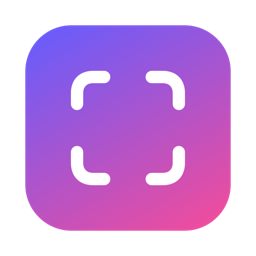
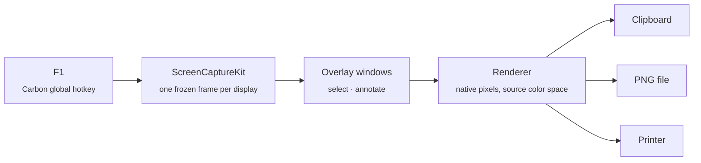

<div align="center">



# Shotmark

**Select. Mark up. Copy. A fast, native screenshot tool that lives in your Mac's menu bar.**


</div>

---

Press **F1** and the screen freezes. Drag to select an area, draw on it, then copy it to the clipboard. The whole thing takes about two seconds and uses no browser, cloud or account.

Shotmark is written in Swift with AppKit and the native frameworks of current macOS, and it compiles to an arm64 binary. It doesn't use Rosetta or Electron, and it doesn't call any deprecated capture APIs.

## Features

- 🎯 **Precise selection**: drag, move, resize with 8 handles, nudge with arrow keys, live pixel-size badge
- ✏️ **Seven annotation tools**: pencil, line, arrow, rectangle, ellipse, highlighter, text
- 📐 **Shift to constrain**: 45° lines and arrows, perfect squares and circles, straight strokes
- 🎨 **Color & width**: preset palette or any color from the system picker; scroll to change stroke width and font size
- ↩️ **Undo / redo** for every mark
- 📋 **Copy, save, print**: PNG on the clipboard, a file anywhere, or the printer
- 🖥️ **Multi-display**: every screen is frozen at its native resolution, and each one is rendered in its own color space
- ⌨️ **Global shortcut you choose**: defaults to F1, rebindable in Preferences
- 🔒 **Private by design**: no network access, no analytics; your screenshots never leave your Mac

## Keyboard shortcuts

| | Action | Keys |
|---|---|---|
| 📸 | Capture | `F1` *(configurable)* |
| ✋ | Move / resize selection | drag inside / drag handles · arrows (`⇧` = 10 px) |
| 🖼️ | Select whole screen | `⌘A` |
| ✏️ | Pencil · Line · Arrow | `P` · `L` · `A` |
| ⬜ | Rectangle · Ellipse | `R` · `E` |
| 🖍️ | Highlighter · Text | `M` · `T` |
| ↩️ | Undo · Redo | `⌘Z` · `⇧⌘Z` |
| 📋 | Copy and close | `⌘C` · `Enter` · double-click |
| 💾 | Save · Print | `⌘S` · `⌘P` |
| ✖️ | Cancel | `Esc` |

Press a tool's key again, or click its button again, to go back to moving the selection.

## Install

Shotmark builds from source with Xcode or just the Command Line Tools (`xcode-select --install`).

```sh
git clone https://github.com/<you>/shotmark.git
cd shotmark
scripts/create-signing-cert.sh   # once: stable local signature (see below)
scripts/build-app.sh --install   # → /Applications/Shotmark.app
open /Applications/Shotmark.app
```

On first launch, allow **Screen Recording** in *System Settings › Privacy & Security › Screen & System Audio Recording*, then pick **Reopen** in the prompt. macOS only applies the permission after the app restarts.

<details>
<summary><b>Why the signing certificate?</b></summary>

macOS ties the Screen Recording permission to the app's code signature. An ad-hoc signature changes on every build, so without a stable certificate you would have to grant the permission again after each rebuild. `create-signing-cert.sh` makes a self-signed certificate that only exists in your login keychain. The first build will ask whether `codesign` may use it; choose **Always Allow**.

</details>

<details>
<summary><b>Personal build settings</b></summary>

`scripts/build-app.sh` reads overrides from an optional, git-ignored `.env.local`:

```sh
APP_NAME=MyShot                       # name shown in Finder, Spotlight and menus
LOCAL_SIGN_NAME="My Local Signing"    # certificate to sign with
```

</details>

## How it works



1. The **hotkey** is registered with `RegisterEventHotKey`. It is still the most reliable way to get a system-wide shortcut, and it works without Accessibility permission.
2. **Capture** uses `SCScreenshotManager` to grab every display at full pixel density before anything is drawn on screen. That's why menus and tooltips stay in the shot.
3. **Overlays** are borderless windows that sit above the menu bar. Each one shows its frozen frame as a GPU layer and draws the selection and annotations on top, so dragging stays smooth even on 5K displays.
4. **Export** re-renders the selection into a bitmap at the display's native resolution and in the capture's color space, so colors match what was on screen.

## Project layout

```
Sources/
├── ShotmarkCore/        # pure logic, fully unit-tested
│   ├── Geometry.swift   #   selection math, handles, snapping, toolbar placement
│   ├── Annotation.swift #   shapes, rendering, undo stack
│   ├── KeyCombo.swift   #   shortcut model ↔ Carbon modifiers
│   └── Palette.swift    #   colors, hex round-trip
└── Shotmark/            # the AppKit app
    ├── AppDelegate      #   menu-bar item, wiring
    ├── HotKey           #   global shortcut
    ├── ScreenCapturer   #   ScreenCaptureKit
    ├── CaptureController#   overlay windows per display
    ├── OverlayView      #   selection, tools, keyboard, export
    ├── Toolbar          #   floating tool / action bars
    └── Preferences      #   shortcut recorder, Retina export, launch at login
```

## Development

```sh
scripts/check.sh   # unit tests → app bundle → assert arm64-only binary
```

CI runs the same script on every push. Contributions are welcome: open an issue first for anything bigger than a bug fix.

## Roadmap

- [ ] Signed & notarized release builds
- [ ] Mac App Store (sandboxed build)
- [ ] Blur / pixelate tool
- [ ] Numbered step markers
- [ ] Magnifier loupe while selecting

## License

[MIT](LICENSE) © 2026 Amanda Natallie
